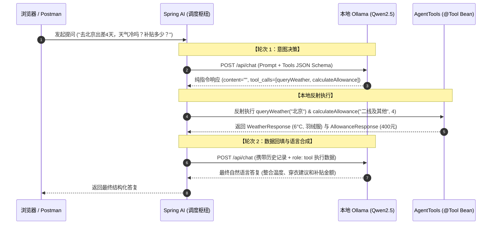
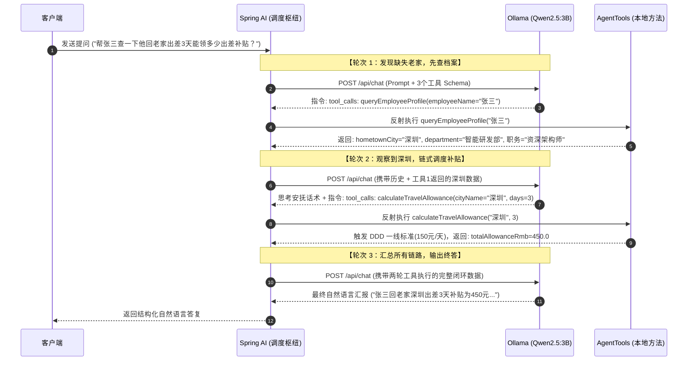

# 🚀 Java 架构师的 AI 全栈工程化落地路线图 (Spring AI 专版)

> **核心定位**：以 Java 为本，将 AI 能力作为"高阶微服务"引入现有架构，掌握从 API 集成、企业级 RAG、Agent 编排到小模型量化部署的全流程。

---

## 阶段零：AI 工程直觉建立（预计 1 - 2 天，碎片时间）

> **目标**：不学理论、不推公式，只建立"模型为什么会这样表现"的工程直觉，指导后续所有工程决策。

### 最小必要认知
- [ ] **Token / Tokenizer**：知道中文一个字 ≈ 1-2 个 token，理解上下文长度限制的本质，理解为什么模型数数不准、JSON 容易截断。
- [ ] **Attention 直觉**：知道模型是"看全文找关联"而非逐字顺序读，理解长文本中间信息容易被忽略（Lost in the Middle 现象）。
- [ ] **幻觉（Hallucination）**：理解模型是"概率续写"不是"查数据库"，知道它为什么会一本正经地胡说八道。
- [ ] **Temperature / Top-P**：调低→确定性强（结构化输出），调高→创造性（文案生成）。
- [ ] **模型能力边界**：擅长总结/改写/分类/抽取/推理；不擅长精确计算/实时信息/长链逻辑。

### 学习方式
- 装好 Ollama + qwen2.5，故意问它不擅长的问题（复杂数学、最新新闻），感受边界。
- 看 1-2 篇 Transformer 直觉解释（推荐 3Blue1Brown 可视化视频，约 20 分钟）。
- 之后直接进入阶段一，遇到不理解的现象再回来查。

> ⚠️ **原则**：你是工程师不是研究员。类比：不需要懂 TCP 拥塞控制的数学证明，但要知道"会丢包、会延迟，所以要重试和超时"。

---

# 阶段一：基础接入与 Spring AI 范式（预计 1 - 2 周）

### 1. 核心概念与运行环境
- [x] **LLM 核心参数**：理解 Token 机制、Context Window 上下文限制、Temperature（随机度）、Top-P 与 System Prompt。
- [x] **本地开发环境**：安装部署 **Ollama**，本地拉取并运行轻量级开源模型（当前环境：`qwen2.5:3b`）。

### 2. Prompt Engineering（高频核心技能）
- [x] **基础技巧**：掌握 Zero-shot / Few-shot 示例驱动、角色设定（System Prompt 设计模式）。
- [x] **思维链（CoT）**：让模型"先想后答"，提升复杂推理任务的准确率。
- [ ] **Prompt 模板管理**：使用 Spring AI 的 `PromptTemplate` 实现 Prompt 版本化与参数化。

### 3. Spring AI 核心组件与配置
- [x] **环境准备**：基于 JDK 21 与 Spring Boot 3.4.5 + Spring AI 1.0.0 创建项目。
- [x] **ChatClient & ChatModel**：掌握 Spring AI 统一模型抽象与 `ChatClient` 链式调用范式。
- [x] **流式输出（Streaming）**：使用 SSE 实现打字机效果，生产环境用户体验刚需。
- [x] **Structured Outputs (结构化输出)**：使用 `.entity()` 强行约束 LLM 返回精准的 Java Bean / JSON 对象。

### 🚩 阶段一实战目标（已完成 ✅）
> 项目路径：`spring-ai-demo/`
> 写一个 Spring Boot REST API，使用 `ChatClient` 调用本地 Ollama 的 `qwen2.5:3b` 模型，支持流式输出，并将 LLM 返回的文本自动反序列化为 Java 的 `List<UserOrderVo>` 实体类。

---

### 📖 阶段一详细学习笔记

#### A. LLM 请求的完整生命周期

理解这张流程图，就理解了 Spring AI 调用模型时"到底发生了什么"：

```
用户输入 (HTTP Request)
  ↓
┌─────────────────────────────────────────────────────┐
│ System Prompt（角色/规则层）                          │
│ 例："你是一个订单信息提取专家..."                     │
│ 作用：定义模型的身份、行为边界、输出规则              │
└─────────────────────────────────────────────────────┘
  ↓
┌─────────────────────────────────────────────────────┐
│ Few-shot 示例（可选）                                │
│ 例：输入:"买了台ThinkPad" → 输出:{orderId:...}       │
│ 作用：让模型"模仿"你期望的格式和推理方式             │
└─────────────────────────────────────────────────────┘
  ↓
┌─────────────────────────────────────────────────────┐
│ User Prompt（具体任务）                              │
│ 例："请从以下文本中提取订单信息：..."                 │
└─────────────────────────────────────────────────────┘
  ↓
┌─────────────────────────────────────────────────────┐
│ 模型生成 token（逐词生成）                           │
│ 受 Temperature / Top-P / Top-K 控制选词策略          │
└─────────────────────────────────────────────────────┘
  ↓
┌─────────────────────────────────────────────────────┐
│ 输出约束（.entity() 注入的 JSON Schema）             │
│ 作用：强制模型只输出合法 JSON，不允许自由发挥         │
│ ⚠️ 这层约束力最强，会压制 System Prompt 的角色设定    │
└─────────────────────────────────────────────────────┘
  ↓
Spring AI 自动反序列化为 Java 对象 (UserOrderVo)
  ↓
返回 HTTP Response (JSON)
```

**关键认知**：各层的优先级为 **输出约束 > System Prompt > Few-shot > User Prompt 措辞**。
这就是为什么改了"毒舌吐槽师"角色但结构化输出没变化——JSON Schema 约束把角色压制了。

---

#### B. 核心概念详解

##### B1. Zero-shot vs Few-shot

| 模式 | 含义 | 代码对应 |
|------|------|----------|
| **Zero-shot** | 直接问，不给任何示例 | `OrderController.batchAnalyze()` — 只说"提取订单"，没给例子 |
| **Few-shot** | 先给 1~3 个"输入→输出"示例，再问 | `OrderController.analyzeOrder()` — 给了 ThinkPad 的示例 |

**实际效果**：对于格式化/提取类任务，Few-shot 比 Zero-shot 准确率通常高 20-40%。
模型"模仿示例"的能力远强于"理解你的文字描述"。

##### B2. CoT（Chain of Thought / 先想后答）

让模型先输出推理过程，再给最终答案。

| 不用 CoT（当前做法） | 用 CoT |
|---------------------|--------|
| "提取订单信息" → 直接输出 JSON | "先分析文本中的商品、数量、金额，然后输出 JSON" |

触发方式：在 Prompt 中加 "请一步一步思考" 或 "Let's think step by step"。

**适用场景**：
- 简单提取 → 不需要 CoT
- 复杂推理（如"判断是否超时 → 计算赔偿"）→ 需要 CoT

**注意**：CoT 和 `.entity()` 有冲突——CoT 要输出思考过程，`.entity()` 要求只输出 JSON。
解决方案：在 Java 对象中加一个 `reasoning` 字段，让模型把思考写进去。

##### B3. Temperature / Top-P / Top-K（选词三旋钮）

模型生成下一个 token 时，会给所有候选词计算概率，然后按以下参数决定怎么选：

| 参数 | 作用 | 比喻 |
|------|------|------|
| **Temperature** | 拉平/拉尖概率分布。越低越确定，越高越随机 | 调节"冒险程度" |
| **Top-K** | 硬截断：只保留概率最高的前 K 个候选 | 菜单只看前 K 道菜 |
| **Top-P** | 软截断：累积概率达到 P 就停止 | 预算花完就停止点菜 |

**Temperature 直觉**：
- 0.1~0.3 = 考试只写标准答案的学霸（适合结构化输出）
- 0.7 = 正常聊天的人（适合日常对话）
- 1.0+ = 喝了两杯酒开始天马行空的朋友（适合创意写作）

**Top-P 示例**（P=0.8）：
```
候选词: 天气(0.4) → 累积0.4
        心情(0.25) → 累积0.65
        晚上(0.15) → 累积0.80 ✓ 截止
        股票(0.08) → 不要了
从 {天气, 心情, 晚上} 中按概率随机选一个
```

**工程实践**：90% 的情况只需调 Temperature，Top-P 保持默认 0.9，Top-K 不用管。

**推荐配置**：
| 场景 | Temperature | Top-P |
|------|-------------|-------|
| 结构化输出 / JSON 提取 | 0.1 ~ 0.3 | 0.9 |
| 日常对话 / 问答 | 0.7 | 0.9 |
| 创意写作 / 头脑风暴 | 1.0+ | 0.95 |

**代码中覆盖全局温度**（针对不同接口用不同温度）：
```java
chatClient.prompt()
    .options(OllamaOptions.builder().temperature(0.1).build())
    .user(...)
    .call()
    .entity(UserOrderVo.class);
```

---

#### C. 项目代码结构与对应知识点

```
spring-ai-demo/
├── pom.xml                              ← Spring Boot 3.4.5 + Spring AI 1.0.0 + Ollama
└── src/main/
    ├── java/com/example/ai/
    │   ├── SpringAiDemoApplication.java ← 启动类
    │   ├── controller/
    │   │   ├── ChatController.java      ← 知识点: ChatClient、.call() vs .stream()、System Prompt
    │   │   └── OrderController.java     ← 知识点: Few-shot、.entity()、Structured Output、ParameterizedTypeReference
    │   └── vo/
    │       └── UserOrderVo.java         ← 知识点: Java Record 作为 JSON Schema 的源
    └── resources/
        └── application.yml              ← 知识点: 模型选择、Temperature 全局配置
```

##### 各文件核心知识点：

**ChatController.java** — 对话与流式：
- `ChatClient.Builder` 注入 → `.defaultSystem()` 设置全局角色
- `.call().content()` = 同步等待完整响应
- `.stream().content()` = 返回 `Flux<String>`，逐 token 推送（SSE）
- 区别就一个词：`call()` vs `stream()`

**OrderController.java** — Prompt 工程 + 结构化输出：
- `analyzeOrder()`: Few-shot 示例 + `.entity(UserOrderVo.class)` 单对象提取
- `batchAnalyze()`: Zero-shot + `.entity(ParameterizedTypeReference<List<...>>)` 批量提取
- `.entity()` 底层原理：Java 类 → JSON Schema → 注入 Prompt → 解析响应 → 反序列化

**application.yml** — 全局配置：
- `spring.ai.ollama.base-url`: Ollama 地址
- `spring.ai.ollama.chat.options.model`: 模型名（必须和 `ollama list` 一致）
- `spring.ai.ollama.chat.options.temperature`: 全局温度

---

#### D. 踩坑记录

| 问题 | 原因 | 解决 |
|------|------|------|
| `model 'qwen2.5:7b' not found` | 配置中的模型名与 Ollama 实际安装的不一致 | 用 `ollama list` 或 `GET /api/tags` 确认实际模型名 |
| 改了 System Prompt 为"毒舌吐槽师"但输出没变化 | `.entity()` 的 JSON Schema 约束优先级高于角色设定 | 角色设定只对自由文本输出（`/ai/chat`）有效 |
| 批量提取时 totalPrice 计算错误（1598→3196） | 3B 小模型推理能力有限，把单价当总价又乘了数量 | 换更大模型 / Prompt 中明确"1598是总价" |

---

#### E. 已验证的 API 接口

| 接口 | 方法 | 功能 | 测试结果 |
|------|------|------|----------|
| `/ai/chat?message=hello` | GET | 同步对话 | ✅ 返回中文回复 |
| `/ai/chat/stream?message=...` | GET (SSE) | 流式对话 | ✅ 逐 token 返回 `data:` 块 |
| `/ai/order/analyze?text=...` | GET | Few-shot 单订单提取 | ✅ 返回 UserOrderVo JSON |
| `/ai/order/batch?text=...` | GET | Zero-shot 批量提取 | ✅ 返回 List JSON |

---

## 阶段二：生产级 RAG & 混合检索架构（预计 2 - 3 周）

### 1. 向量化与向量数据库 (Vector Store)
- [ ] **Embedding 模型**：理解文本向量化原理，集成本地 `bge-large-zh` 或云端 Embedding API。
- [ ] **Spring AI VectorStore**：掌握 Spring AI 的 `VectorStore` 抽象，对接 **PGVector** (PostgreSQL 扩展) 或 **Qdrant / Milvus**。
- [ ] **文档解析（生产大坑）**：PDF 表格提取、扫描件 OCR、Word 嵌套图片处理——实际生产中 80% 时间花在这里。
- [ ] **Chunking 策略**：对比实验 Fixed-size / Recursive / Semantic Chunking，理解 Overlap 对召回率的影响。

### 2. 高阶 RAG 与混合检索 (Hybrid RAG)
- [ ] **Spring AI QuestionAnswerAdvisor**：使用内置 Advisor 快速搭建基础 RAG 链。
- [ ] **多路并发召回 (Parallel Hybrid Retrieval)**：
  - 使用 Java `CompletableFuture` 异步并行请求 **Vector Store (向量相似度)** 与 **Full-text / Graph Store (关键字/图谱)**。
- [ ] **Re-ranking (重排序)**：集成 BGE-Reranker 模型，对多路召回的候选文档打分过滤，去除向量噪声。
- [ ] **细粒度数据隔离**：利用 Vector DB 的 MetaData Filtering，实现基于 Spring Security 权限的"租户/部门级"数据检索隔离。

### 3. RAG 评估体系（从"能用"到"好用"）
- [ ] **评估指标**：理解 Faithfulness（忠实度）、Answer Relevance（答案相关性）、Context Recall（召回率）。
- [ ] **评估工具**：使用 **RAGAS** 或自建评估集，对 RAG 效果进行量化打分，避免"感觉还行"式开发。
- [ ] **Bad Case 分析**：建立错误案例库，针对性优化 Chunking / Retrieval / Prompt 各环节。

### 🚩 阶段二实战目标
> 基于 `SpringAiHybridRetriever`，手写一个企业内部 API 文档/规章制度问答系统，支持上传 Markdown 自动向量化入库，并通过"向量 + 关键字"双路并发召回与重排序返回高准确率回答。附带一套评估脚本，能量化回答质量。

---

### 📖 阶段二详细学习笔记（基础 RAG 已完成 ✅）

#### A. RAG 架构三角色分工

```
Ollama  负责"理解"（Embedding 向量化 + LLM 生成回答）
Qdrant  负责"记忆"（存向量 + 比较相似度，它自己不理解文字）
Spring AI 负责"协调"（决定什么时候找谁）
```

Ollama 里同时跑两个模型，各管各的事：

| 模型 | 类型 | 职责 | 何时被调用 |
|------|------|------|-----------|
| qwen2.5:3b | Chat 模型 | 理解问题、生成回答 | 最后一步 |
| Embedding 模型 | 向量化模型 | 把文字变成一组数字（向量） | 摄入时 + 查询时各一次 |

#### B. 向量模型（Embedding Model）的作用

**本质：把文字翻译成数字，让"语义相似度"可以被数学计算。**

```
"病假工资规定"  → Embedding模型 → [0.12, -0.34, 0.56, ...]（几百个数字）
"生病请假扣钱吗" → Embedding模型 → [0.11, -0.30, 0.52, ...]（数字很接近！）
"出差住宿标准"  → Embedding模型 → [-0.45, 0.22, 0.08, ...]（数字差很远）
```

- 语义相近的文字 → 向量距离近；无关的文字 → 向量距离远
- 向量模型的质量决定"翻译"准不准：差的模型翻译不出"生病≈病假"这种等价关系
- **注意**：不同模型的向量不在同一数学空间，换模型必须清空重建所有向量

#### C. RAG 一次查询的完整流程（8 步，标注每步由谁执行）

```
用户问："生病35天能拿多少工资"
  │
① [Spring Boot] 收到请求（/rag/ask）
  │
② [Ollama - Embedding模型] 问题向量化 → 得到查询向量 [0.11, -0.30, ...]
  │
③ [Spring AI] 拿向量去问 Qdrant（gRPC 6334）："哪些存储的向量最像？"
  │
④ [Qdrant] 纯数学计算（余弦距离），返回 Top-K 个最相似的片段
  │
⑤ [Spring AI] 按 similarityThreshold 过滤掉分数不达标的片段
  │
⑥ [Spring AI] 把幸存片段原文 + 用户问题拼成 Prompt：
   "根据以下参考资料回答问题：{片段1}{片段2}... 问题：生病35天能拿多少工资"
  │
⑦ [Ollama - Chat模型 qwen2.5:3b] 基于 Prompt 生成回答
  │
⑧ [Spring Boot] 回答返回给用户
```

**Ollama 在整个流程中被调用了两次**（步骤②和⑦），但用的是两个不同的模型：
- 步骤② 用 **Embedding 模型**（qwen3-embedding:0.6b）：只负责把文字变向量，不生成文字
- 步骤⑦ 用 **Chat 模型**（qwen2.5:3b）：只负责理解和生成回答

**关键认知**：步骤②④⑤ 决定"能不能找到资料"（检索层），步骤⑦ 决定"能不能答对"（推理层）。两层问题要分开定位。

**摄入阶段同理**：文档切片后也是先经 Ollama 的 Embedding 模型向量化，再存入 Qdrant。查询向量和存储向量必须由同一个模型产生，否则无法比较。

#### C+. Ollama 常用命令速查

Ollama 是本地模型的"运行时环境"，类比 JVM 之于 Java 程序：模型文件 ≈ jar 包。

| 命令 | 作用 | 示例 |
|------|------|------|
| `ollama list` | 查看本地已安装的模型 | — |
| `ollama pull <模型>` | 下载模型（新增，不覆盖旧的） | `ollama pull qwen3-embedding:0.6b` |
| `ollama rm <模型>` | 删除某个模型 | `ollama rm nomic-embed-text` |
| `ollama run <模型>` | 命令行直接对话（快速测试模型能力） | `ollama run qwen2.5:3b` |
| `ollama serve` | 启动服务（Windows 上通常自启动，端口 11434） | — |
| `GET http://localhost:11434/api/tags` | REST API 查模型列表（程序用） | — |

本项目用到的模型清单（`ollama list` 可验证）：

| 模型 | 用途 | 配置位置 |
|------|------|----------|
| qwen2.5:3b | Chat 对话/生成回答 | `spring.ai.ollama.chat.options.model` |
| qwen3-embedding:0.6b | 向量化（RAG 用） | `spring.ai.ollama.embedding.options.model` |
| nomic-embed-text | 代码插件的向量缓存用（勿删） | 不在本项目配置中 |

#### D. Embedding 模型选型决策（重要）

| 模型 | 开发方 | 大小 | 中文效果 | 结论 |
|------|--------|------|----------|------|
| nomic-embed-text | Nomic AI（美） | ~274MB | 分数区分度差：相关/无关片段都挤在 0.36~0.42，无法分层，threshold 无从下手 | ❌ 已弃用 |
| **qwen3-embedding:0.6b** | 阿里通义 | ~639MB | 强 | ✅ **已上线验证**（电脑配置低，省资源） |
| **bge-m3** | 智源 BAAI | ~1.2GB | 强，中文社区最主流 | 📌 **备选**（机器升级后切换对比） |

**换模型验证结果（2026-08-03）**：
- 流程：ollama pull → 改配置 → DELETE collection → 重启 → 重新 ingest
- /rag/debug：正确片段稳居 Rank 1，无重复数据，相关/无关片段分数分层更清晰
- /rag/ask：从"找不到信息"进步到正确引用制度原文（"超过30天部分按80%发放"）
- 结论：检索层毕业；"无法算出具体金额"是合理行为（资料未含基本工资，RAG 不编造）

其他了解：
- **GTE 系列**：阿里达摩院早期作品，轻量通用
- **阿里云百炼 text-embedding-v3**：云端 API，按量付费

#### E. 项目代码与接口（spring-ai-demo）

| 接口 | 功能 |
|------|------|
| `POST /rag/ingest` | 默认参数摄入 docs/*.md |
| `POST /rag/reingest?chunkSize=N` | 自定义切片参数摄入（Chunking 实验用） |
| `POST /rag/clear` | 删除 Qdrant collection（调 REST API 6333） |
| `GET /rag/ask?question=...` | 完整 RAG 问答 |
| `GET /rag/ask/filter?question=...&source=xxx.md` | MetaData 过滤（数据隔离） |
| `GET /rag/debug?question=...&topK=5&threshold=0.0&full=true` | **检索透视**：只看召回片段和 score，不调 LLM；full=true 返回完整内容 |
| `GET /rag/chunks/preview?chunkSize=N` | **切片预览**：免向量化免入库，秒级看不同 chunkSize 的切块效果 |
| `GET /rag/chunks/stats` | **入库统计**：查 Qdrant 中各 source 的切片数量，验证重复摄入 |

数据隔离方案：单 Collection + MetaData 过滤（`source` 字段，类似 SQL WHERE），后续资料多了再拆多 Collection。

**Chunking 研究流程**（免反复重建的快速循环）：
```
① /rag/chunks/preview?chunkSize=200/800/2000 → 秒级对比切块效果
② 确认满意后才 /rag/clear + /rag/reingest?chunkSize=N 正式入库
③ /rag/debug 验证检索效果，/rag/chunks/stats 验证无重复
```

**后续进阶计划（2026-08-06 更新，下一步优先做评估）**：
- **[下一步] 轻量评估集**：写 10~20 个 (问题, 期望答案要素) 问答对，脚本批量调 /rag/ask 并自动打分（召回 + 答案两个维度）——本次 chunking 实验已暴露单次回答有随机性（同问题两次答案一好一坏），**没有量化指标就调优等于猜**
- **Re-ranking 重排序**：BGE-Reranker 逐条精判相关性，干掉"蹭概念"噪声（如婚假片段蹭"工资"排 rank 2）
- **混合检索**：向量 + 关键词双路并发，互补盲区
- **RAGAS 评估**：业界标准框架，替代自建脚本

#### E+. 接口返回与字段速查（真实样本，2026-08-05 实验）

> 完整原始 JSON 在 `experiment-results/` 目录，以下为复习用精选。

**① GET /rag/ask?question=...** —— 返回纯文本回答

<details>
<summary>📄 真实返回（chunkSize=200 轮，计算正确的那次）</summary>

```text
根据参考资料中的规定，如果员工累计请病假超过30天但不超过180天（本文中提到的禁代领、冒领的情况通常适用于连续病假超过6个月），那么超过的部分将按照基本工资的80%发放。

您的情况是，请病假共计35天。前30天，员工的基本工资全额发放；对于剩下的5天，请病假工资为基本工资的80%，即按日平均工资计算（8000元除以21.75天约等于367.82元/天），那么这5天的病假工资就是：367.82元/天 * 5天 * 80% = 1471.26元。

因此，按照公司病假工资计算方式，您的病假期间总工资将为前30天的基本工资加上您请病假剩余的5天按基本工资80%发放的工资。
```

⚠️ 注意：同样的问题在 chunkSize=800 轮的答案全是错的（假设基薪12000、算出"36−35=1天"）——小模型单次回答有随机性，调优必须多轮对比
</details>

**② GET /rag/debug?question=&topK=&threshold=&full=** —— 检索透视 JSON

| 字段 | 含义 | 复习要点 |
|------|------|----------|
| question | 原问题 | — |
| params.topK / threshold | 本次查询参数 | threshold 是查询时参数，免重建 |
| total_hits | 实际召回条数 | ≤ topK（threshold 过滤后） |
| hits[].rank | 排名 | score 升序 |
| hits[].score | 余弦**距离** | **越小越相关**；跨模型不可横向比较 |
| hits[].source | 来源文件 | 数据隔离的 metadata 字段 |
| hits[].content / content_length | 片段内容 | full=true 不截断 |

<details>
<summary>📄 真实返回（chunkSize=200 轮，topK=5，截取前 2 条）</summary>

```json
{"question":"生病 35天我能拿多少工资","params":{"threshold":0.0,"topK":5},"total_hits":5,
"hits":[
 {"rank":1,"score":0.34256715,"source":"company-salary-policy.md","content":"资合计为8000元加上1471.26元...","content_length":221},
 {"rank":2,"score":0.34418094,"source":"company-salary-policy.md","content":"假工资的计算基数为员工的基本工资...","content_length":205}
]}
```
</details>

**③ GET /rag/chunks/preview?chunkSize=N** —— 切块预览（免向量化免入库）

<details>
<summary>📄 真实返回（chunkSize=200，只看 salary 文件）</summary>

```json
{"params":{"chunkSize":200},"total_chunks":21,
"files":[
 {"file":"company-salary-policy.md","sections_after_md_reader":2,"chunks_after_token_splitter":9,"chunks":[...]}
]}
```

关键字段：`sections_after_md_reader`（Markdown 标题切出的节数，= ## 数量）与 `chunks_after_token_splitter`（第二层切完的块数）
</details>

**④ GET /rag/chunks/stats** —— 入库统计（验证重复摄入）

```json
{"collection":"knowledge-base","total_points":15,"by_source":{"company-expense-policy.md":4,"company-leave-policy.md":4,"company-salary-policy.md":3,"spring-ai-guide.md":4}}
```

**⑤ POST /rag/clear** —— 删除 + 立即重建（免重启，2026-08-05 升级）

```json
{"message":"Collection 'knowledge-base' 已清空并重建，无需重启",
 "embedding_dimensions":1024,
 "delete_response":"ok", "create_response":"ok",
 "next_step":"现在直接调用 POST /rag/reingest?chunkSize=xxx 重新摄入"}
```

#### E++. 关键代码速查（可折叠）

<details>
<summary>📄 application.yml — 完整配置（模型 / 向量库 / 端口 / 日志）</summary>

```yaml
spring:
  ai:
    ollama:
      base-url: http://localhost:11434
      chat:
        options:
          model: qwen2.5:3b
          temperature: 0.7
      embedding:
        options:
          model: qwen3-embedding:0.6b
    vectorstore:
      qdrant:
        host: localhost
        port: 6334
        collection-name: knowledge-base
        initialize-schema: true

server:
  port: 8080

logging:
  level:
    org.springframework.ai.chat.client.advisor: DEBUG
```
</details>

<details>
<summary>📄 RagController.java — QA 模板 + Advisor 装配（核心）</summary>

```java
// 自定义中文 QA 模板：占位符必须叫 {question_answer_context}（Advisor 写死，不是直觉的 context）
// 模板文本避免括号（StringTemplate 会当表达式解析）
private static final PromptTemplate QA_TEMPLATE = new PromptTemplate("""
        以下是参考资料：
        ---------------------
        {question_answer_context}
        ---------------------
        请根据参考资料回答用户问题，要求：
        1. 如果资料中包含与问题相关的规则或条款，必须引用并应用到用户的具体情况中推理
        2. 即使无法给出精确数字，也要说明适用的规则和计算方式
        3. 只有资料中完全没有相关信息时，才告知用户无法回答
        用户问题：{query}
        """);

// RAG 问答：一行 .advisors() 完成"检索 + 拼接 + 生成"
return chatClient.prompt()
        .advisors(QuestionAnswerAdvisor.builder(vectorStore)
                .searchRequest(SearchRequest.builder()
                        .topK(5)
                        .similarityThreshold(0.0)   // 中文 Embedding 分数偏低，不能设太高
                        .build())
                .promptTemplate(QA_TEMPLATE)
                .build())
        .user(question)
        .call()
        .content();
```
</details>

<details>
<summary>📄 RagDebugController.java — 诊断四件套（debug / preview / stats / clear）</summary>

```java
// ① 检索透视：只看召回，不调 LLM
vectorStore.similaritySearch(SearchRequest.builder()
        .query(question).topK(topK).similarityThreshold(threshold).build());

// ② 切片预览：免向量化免入库，瞬间对比 chunkSize
// chunkSize 是 token 窗口预算；切点会回拉到 ASCII 标点；中文"。"不认；350字以下硬切可能产生乱码
TokenTextSplitter splitter = new TokenTextSplitter(chunkSize, minChunkSizeChars, 5, 100, true);

// ③ 已入库统计：Qdrant REST scroll 按 source 计数
// 同一 source 数量翻倍 = 重复摄入了，先 /rag/clear 再摄入
qdrantHttpClient.post().uri("/collections/{name}/points/scroll", collectionName) ...

// ④ 清空：删除后立即重建空库（Cosine + embedding 维度），免重启
// 否则 initialize-schema 只在启动时建库，clear 后必须重启才能 ingest（历史踩坑）
int dimensions = embeddingModel.dimensions();
qdrantHttpClient.put().uri("/collections/{name}", collectionName)
        .body(Map.of("vectors", Map.of("size", dimensions, "distance", "Cosine"))) ...
```
</details>

<details>
<summary>📄 pom.xml — RAG 相关 4 个依赖</summary>

```xml
<!-- Ollama：Chat + Embedding -->
<dependency>
    <groupId>org.springframework.ai</groupId>
    <artifactId>spring-ai-starter-model-ollama</artifactId>
</dependency>
<!-- Qdrant 向量库 -->
<dependency>
    <groupId>org.springframework.ai</groupId>
    <artifactId>spring-ai-starter-vector-store-qdrant</artifactId>
</dependency>
<!-- Markdown 文档解析器 -->
<dependency>
    <groupId>org.springframework.ai</groupId>
    <artifactId>spring-ai-markdown-document-reader</artifactId>
</dependency>
<!-- QuestionAnswerAdvisor 所在模块（1.0.0 起独立成包） -->
<dependency>
    <groupId>org.springframework.ai</groupId>
    <artifactId>spring-ai-advisors-vector-store</artifactId>
</dependency>
```
</details>

#### F. 关键参数详解

| 参数 | 含义 | 调优方向 |
|------|------|----------|
| topK | 取回最相似的前 K 个片段 | 太小漏答案，太大噪声多 |
| similarityThreshold | 分数不达标的片段丢弃 | **取决于模型分数分布**，用 /rag/debug 观察实际 score 再定 |
| chunkSize | 每片最大 token 数 | 制度/FAQ 200-400；技术文档 600-1000；长文 1000-1500 |
| overlap | 相邻切片重叠 token 数 | 防关键句子被切断，一般为 chunkSize 的 10-20% |
| score/debug 接口 | 向量距离，**越小越相关**，rank 按 score 升序 | — |

**rank vs score 怎么看**：rank 就是 score 的排序结果，不是两个独立指标。生产判断两条：
1. 正确片段 rank ≤ topK → 能答出的前提
2. 相关与无关片段的 score 差距越大越好（分层清晰 = 检索质量高）

**score 与 threshold 的换算**（容易踩坑）：debug 显示的 score 是**距离**，Spring AI 内部用 **相似度 = 1 - 距离** 与 threshold 比较：
```
例：片段距离 0.511 → 相似度 0.489
    threshold=0.3 → 0.489 >= 0.3 保留
    threshold=0.5 → 0.489 < 0.5  过滤
所以 rank 1 片段距离 0.36，真实"匹配分"（相似度）是 0.64
```

**score 方向判断口诀**：我们当前 score = 距离，**越小越好**（0=完全匹配，1=无关，2=完全相反）。但不同系统显示习惯不同：

| 显示的是什么 | 方向 |
|--------------|------|
| 距离 distance | 越小越好（我们的 debug） |
| 相似度 similarity | 越大越好 |
| 点积 dot product | 越大越好 |

接触陌生向量库/检索工具时，先拿一个肯定相关的查询试一下，看分数高低即可判断方向。

**"相关/无关片段"不是系统算出来的，是人读内容判断的**：Qdrant 只保证返回"最像的 Top-K"，不保证里面有答案。debug 接口的 content_preview 就是给人读来判断用的。无关片段能排进 Top-K 是因为与问题有概念重叠（如婚假片段蹭上了"工资"关键词）。生产中用三种手段自动化这个判断：similarityThreshold（粗暴版）/ Re-ranking 重排序模型（精细版）/ RAGAS 评估集（离线量化版）。

#### F+. similarityThreshold 详解

**定义**：检索结果的最低相似度门槛（debug 接口的 threshold 参数就是它）。完整链路：

```
Qdrant 返回 Top-K 结果 → Spring AI 逐条检查：相似度(1-距离) >= similarityThreshold?
  ├── 达标 → 保留，进入 Prompt
  └── 不达标 → 丢弃
```

**关键行为**：
1. 在 **Top-K 之后**生效：topK=5 + threshold=0.5 时，最终可能少于 5 条
2. 设太高 → 召回为空（"找不到相关信息"）；设太低 → 噪声进 Prompt 干扰回答
3. 查询时参数，实时调整免重建
4. 合理值必须实测：用 /rag/debug 观察正确片段与噪声的相似度分界，设在分界以下

#### G. 踩坑记录

| 问题 | 根因 | 解决 |
|------|------|------|
| "生病35天工资"答不出 | 当时误诊为 threshold 过滤（后实验证伪：nomic 下 0.5 也未过滤任何片段）；真正原因是英文 QA 模板拒答指令 + 小模型字面匹配（见 G++ 节） | 自定义中文 QA 模板根治；降 threshold 当时"生效"实为小模型随机性 |
| debug 出现重复片段 | 多次 ingest 追加写入 | 先 /rag/clear 再摄入 |
| clear 后 ingest 报 500 | collection 删除后需重启才能重建（initialize-schema 只在启动时建） | 已根治：/rag/clear 升级为"删除+立即重建空库"（Cosine+embedding维度），无需重启（2026-08-05） |
| Qdrant 连接失败 | Docker 未映射 gRPC 6334 | `-p 6333:6333 -p 6334:6334` |
| 年假天数答错（8年→10天） | 检索正确，3B 模型推理弱 | 换大 Chat 模型 / 加 CoT / 数值计算用代码兜底 |
| nomic 下 threshold=0.5 完全不过滤 | 非归一化向量的余弦距离与 Spring AI 假定的相似度范围不匹配 | 换归一化模型（qwen3）后 threshold 恢复正常工作 |
| 检索正确但模型拒答"没有相关信息" | QuestionAnswerAdvisor 默认英文模板含拒答指令，小模型对"35天"做字面匹配后摆烂 | 自定义中文 QA 模板，明确要求"把规则应用到用户情况" |
| 自定义模板报 "Missing variable: context" | Advisor 写死的上下文占位符是 `{question_answer_context}`，不是 `{context}` | 改名；另外模板文本避免括号（StringTemplate 会当表达式解析） |

#### G+. 对照实验：threshold × Embedding 模型（2026-08-03）

同一问题"生病35天工资"，扫描不同 threshold 的召回数：

| threshold | qwen3-embedding:0.6b | nomic-embed-text |
|-----------|----------------------|------------------|
| 0.0~0.3 | 5 hits（全保留） | 5 hits（全保留） |
| 0.5 | **4 hits**（过滤掉 1 条噪声） | 5 hits（**完全不过滤！**） |

**实验结论**：
1. **threshold 是查询时参数**：随便调，不用重新 ingest；只有换模型/换 chunkSize 才需要重建
2. **threshold 的有效性取决于模型的分数区分度**：nomic 把所有分数压缩在 0.36~0.42（相关/无关分不开，threshold 无从下手）；qwen3 分层清晰 0.36 vs 0.51，threshold 能正常工作。换模型后必须重新实测分数分布再定阈值
3. qwen3 下正确片段 score≈0.355，噪声≈0.51，threshold=0.3~0.5 都安全
4. **不同模型的 score 不能横向比较**：nomic 的 0.36 和 qwen3 的 0.36 语义不同（分数分布模式不同），"0.36=64%匹配"的换算只在同一模型内有效

#### G++. 排查案例：检索正确但模型拒答（2026-08-03）

**现象**：/rag/debug 显示正确片段 rank 1，但 /rag/ask 回答"没有相关信息"。

**排查手段**：`SimpleLoggerAdvisor` + `logging.level.org.springframework.ai.chat.client.advisor: DEBUG`，直接看发给 LLM 的完整 Prompt。

**SimpleLoggerAdvisor 具体接入方式**（两步）：

第1步：给 ChatClient 挂上日志 Advisor（RagController 构造器）：
```java
this.chatClient = builder
        .defaultSystem("你是一个企业知识库助手...")
        .defaultAdvisors(new SimpleLoggerAdvisor())  // ← 加这一行
        .build();
```

第2步：开 DEBUG 日志（application.yml，它默认是 DEBUG 级别输出，不开看不到）：
```yaml
logging:
  level:
    org.springframework.ai.chat.client.advisor: DEBUG
```

之后每次请求，控制台会打印两条关键日志：
- `request: ChatClientRequest[prompt=...]` → 发给 LLM 的完整 Prompt（含拼接后的资料）
- `response: {...}` → 模型返回原文 + token 用量

**日志铁证**：
- `qa_retrieved_documents` 里病假规则片段 score=0.64，检索无误
- UserMessage 里完整包含"超过30天部分按80%发放"，拼接无误
- 但 Prompt 尾部是默认英文模板："If the answer is not in the context, inform the user that you can't answer" → 小模型字面匹配"35天"未果，直接拒答

**修复过程（含踩坑时间线）**：

| 尝试 | 做法 | 结果 |
|------|------|------|
| 第1次 | 自定义中文模板，占位符写 `{context}` | ❌ 500 报错 "Missing variable names are: [context]" |
| 第2次 | 怀疑括号解析问题，想加 `StTemplateRenderer.builder().expression(false)` | ❌ 编译失败，该方法不存在 |
| 第3次 | javap 反编译官方类，发现占位符真名是 `{question_answer_context}`；改名 + 模板文本去括号 | ✅ 成功 |

坑点总结：
1. Advisor 写死的上下文 key 是 `question_answer_context`，不是直觉上的 `context`（看日志里的 context map 或反编译确认）
2. StringTemplate 引擎可能把模板文本里的括号当表达式，模板文案尽量不用括号
3. 自定义模板用 `.promptTemplate(QA_TEMPLATE)` 挂到 QuestionAnswerAdvisor.builder 上

**最终验证结果**（测试 URL：`/rag/ask?question=生病35天我能拿多少工资`）：

> 根据参考资料中的信息，员工每年累计病假不超过30天，超过部分按基本工资的80%发放。因此，如果员工在一年内生病休假达35天，则超出的部分为5天（35-30=5）。按照80%发放的规定，这5天的工资将被计算为该员工的基本工资乘以80%……由于具体的工资基数在您提供的信息中未提及，我们只能根据规则来进行表述。

✅ 引用规则 + ✅ 代入推理（35-30=5） + ✅ 诚实说明缺工资基数——教科书级的 RAG 回答。

**结论**：RAG 三层定位法——①检索层（/rag/debug）②拼接层（SimpleLoggerAdvisor 看 Prompt）③推理层（换模板/换模型）。本次问题在第三层。

**发现英文模板的证据**：SimpleLoggerAdvisor 打印的 UserMessage 里直接可见 "Context information is below..." 和 "If the answer is not in the context...can't answer" 英文段落；再用 javap 反编译 QuestionAnswerAdvisor.class 确认 DEFAULT_PROMPT_TEMPLATE 常量，证据链闭环。

#### QA 模板是什么？

RAG "最后一道工序的装配图纸"——决定检索到的资料和问题如何组装成发给 LLM 的最终 Prompt：

```
模板骨架的三个槽位：
  {question_answer_context} ← Advisor 自动填入检索到的片段
  {query}                   ← 自动填入用户问题
  回答指令                  ← 模板里写死的规则（决定模型行为的关键！）
```

同样的资料和问题，指令不同行为完全不同：默认英文指令倾向拒答；自定义指令"必须应用规则推理"后模型主动算出 35-30=5天。

类比：检索给的是食材，QA 模板是菜谱——菜谱写"没有完全匹配的食材就不许做菜"，厨师就摆烂了。

#### H. 关键经验

1. **RAG 问题分层定位**：先 /rag/debug 看召回 → 召回没问题再看模型推理
2. **换 Embedding 模型 = 必须清空重建**：新旧向量不在同一数学空间
3. **initialize-schema: true 只建不删**，重启不丢数据
4. **向量数据库选型影响小**，Embedding 模型和 Chunking 影响大
5. 生产环境必备诊断能力（debug 接口），否则调优全靠猜
6. **排查 RAG 拼接问题**：给 ChatClient 加 `SimpleLoggerAdvisor` + 配置 `logging.level.org.springframework.ai.chat.client.advisor: DEBUG`，可看到发给 LLM 的完整 Prompt
7. 小模型（3B）回答有随机性：同样的问题多次调用结果可能不同，验证效果要多试几次

#### I. Chunking 切片详解（RAG 效果第一大影响因素）

##### chunkSize 的单位：Token（不是字符！）

`TokenTextSplitter` 用 jtokkit（OpenAI tiktoken 的 Java 移植）计数：

| 语言 | 换算关系 | chunkSize=800 ≈ |
|------|----------|-----------------|
| 英文 | 1 token ≈ 4 字母 | ~600 个单词 |
| 中文 | 1 汉字 ≈ 1~2 token | ~400~800 个汉字 |

`TokenTextSplitter` 五个参数：chunkSize=800（每片最大token）/ minChunkSizeChars=350（太短合并）/ minChunkLengthToEmbed=5（太短丢弃）/ maxNumChunks=100 / keepSeparator=true

##### 四种切片策略对比

| 策略 | 原理 | 优点 | 缺点 | 本项目现状 |
|------|------|------|------|-----------|
| ① Fixed-size 固定长度 | 每 N token 硬切一刀 | 简单、快、可预测 | 可能把规则拦腰切断（实测切出乱码，见 I++） | ✅ TokenTextSplitter |
| ② Recursive 递归切分 | 优先按大分隔符切（\n\n→\n→。→空格），尽量保持段落完整 | 语义完整性好，LangChain/Dify/RAGFlow 的切块内核 | Spring AI 无内置，需手写 | ❌ 评估集后第一个手写项目（见 I++） |
| ③ Structure-aware 结构感知 | 按文档结构切（Markdown 标题、HTML） | 天然对齐文档逻辑单元 | 依赖文档有良好结构 | ✅ MarkdownDocumentReader |
| ④ Semantic 语义切分 | 逐句向量化，相邻句相似度骤降处切 | 理论最智能 | 慢、贵、复杂 | ❌ 进阶内容 |

##### 本项目实际是两层切片

```
Markdown 文件
  → 第1层：MarkdownDocumentReader 按标题结构切（## 年假规定 / ## 病假规定...）
  → 第2层：TokenTextSplitter 某节超过 800 token 时再按 token 硬切
  → chunks 入 Qdrant
```

测试文档每节都短，第2层基本未生效，所以效果好；长文档（5000字+）会暴露 Fixed-size 的缺点——I+ 实验已实锤：不认中文"。"、切点落在汉字中间产生乱码。

##### 调优经验法则

| 文档类型 | 推荐 chunkSize | 原因 |
|----------|---------------|------|
| 制度/FAQ（条目式） | 200~400 | 每条规则本身短，切太大混入无关条目 |
| 技术文档（段落式） | 600~1000 | 一个概念需要整段才说清 |
| 合同/论文（长文） | 1000~1500 | 保留完整推理链 |

调优反馈环：默认 800 先跑 → /rag/debug 看召回 → 答案被切成两半→加 overlap；噪声太多→减 chunkSize

实验工具：`POST /rag/reingest?chunkSize=N`（换 chunkSize 必须重新 ingest，因为影响存储的向量内容）

##### I++. 递归切分与 Parent-Child 进阶策略（2026-08-06）

**① Recursive 递归切分——"非结构化长文本"的通用解**

机制：分隔符按粒度从粗到细排队 `[\n\n, \n, 。, ！, ？, ；, 空格]`，先用最粗的切；切出的块还超 chunkSize，就对该块递归换更细分隔符；最后把句子攒到接近 chunkSize 在句子边界封块。

```
拿 salary 文档 1350 字大块（chunkSize=400字）演示：
第1层：按 \n\n 切 → 3 段（470/620/500 字）都超 400
第2层：对每段按 "。" 切 → 一堆完整句子
第3层：攒句子到接近 400 字 → 句子边界封块
结果：每块都以"。"结尾，句子永远完整，汉字永不被劈开
```

与 TokenTextSplitter 的关系：后者是递归思想的"残血版"——只有一级回拉且只认 ASCII 标点。递归版在字符层操作（不碰字节 token），同时治好"不认中文。"与"乱码"两个病。

**实际使用场景**（共同特征：文档没有标题结构，但有自然的段落/句子边界）：

| 场景 | 例子 |
|------|------|
| 合同/法律文书 | 采购合同、保密协议——Word/PDF 提取后是纯文本段落堆 |
| 制度文件 PDF 版 | 红头文件提取后结构丢失，只剩段落和"第X条" |
| 工单/客服记录 | 用户投诉描述、处理记录——纯自然语言长文本 |
| 新闻/研报/邮件/会议转写 | 爬取网页正文、行业报告、语音转文字纪要 |

谁在生产环境用它：LangChain 的 RecursiveCharacterTextSplitter 是官方默认推荐；**Dify、RAGFlow 等国内主流 RAG 平台的"自动切分"内核就是多级分隔符递归**（中文标点原生支持）。反过来：结构良好的 Markdown（我们的测试文档）用结构感知更好；代码用 AST 切；表格按行切——不要迷信单一策略。

**② Parent-Child 双层切分——解"检索准 vs 上下文全"的矛盾**

I+ 实验的痛点：小切片（200）检索准但上下文碎；大切片（800）上下文全但向量被"语义平均"检索被稀释。Parent-Child 一刀解决：

```
摄入：同一文档切两层——大块 Parent（~1500 token）+ 小块 Child（~200 token）；
      child 的 metadata 记 parent_id，parent 单独存（同 collection 加 type=parent 或另开 collection）
检索：问题只和 Child 比相似度 → 粒度细、命中准
组装：命中的 children 按 parent_id 归组 → 取 Parent 原文塞进 Prompt → 上下文完整
```

轻量变体 **Sentence Window Retrieval**：命中某句后自动带上前后 N 句——改动最小，适合入门实现。Spring AI 1.0.0 两者均无内置，需手写。

**③ 术语澄清**：部分文章把"按标题/段落切"称为"语义切块"；业界主流语境里 **Semantic Chunking 指逐句向量化、相邻句相似度骤降处下刀**（不依赖文档结构）。本路线图采用后一定义，阅读外部文章时注意区分。

**学习顺序**：先建评估集（尺子，见下节 J）→ 用评估集公平对比：递归切分 / Parent-Child / overlap 手写实现。

##### I+. Chunking 实战实验：chunkSize 200 vs 800（2026-08-05）

**实验设计**：新增长文测试文档 `company-salary-policy.md`——主体 3 大段（~1350 字）**故意不加 `##` 标题**，只有结尾一个 `## 附则`，让 MarkdownDocumentReader 只切出 2 节（1 大块 + 附则），逼第二层 TokenTextSplitter 必须工作。原有 3 个短文档（每节 71~267 字）作为对照组：三组 chunkSize 下切块完全一致，证明"短节根本不触发第二层"。配套新增 `/rag/chunks/preview`（免入库预览切块）与 `/rag/chunks/stats`（Qdrant 存量统计）。

**TokenTextSplitter 源码级发现**（反编译 `doSplit` 确认）：
1. **chunkSize 是"token 窗口预算"，不是最终块大小**：取 chunkSize 个 token 解码后，回找最后一个 ASCII 标点把切点回拉
2. **只认 ASCII 标点 `. ? ! \n`，中文"。"完全不认**：实验中所有智能切点都是数字的小数点（1471.、18620.）；纯中文无数字时全程硬切
3. **minChunkSizeChars=350 是"智能回拉启用门槛"**：块不足 350 字时直接硬切 → 切点可能落在汉字中间 → **乱码**（实验中"病"字被劈成 ``）
4. **Spring AI 1.0.0 的 TokenTextSplitter 无 overlap 支持**（Builder 源码证实），`/rag/reingest` 的 overlap 参数是无效死代码

**召回对比**（问题：生病35天我能拿多少工资，topK=5）：

| 维度 | chunkSize=200 | chunkSize=800 |
|------|---------------|---------------|
| 总块数 | 21（salary 9） | 15（salary 3） |
| 答案分布 | 规则 rank5、两算例 rank1/2，拆 3 片 | 规则+两算例同 rank1（643字大块） |
| 回答质量 | ✅ 计算正确：30天全额+5天×80%×日薪(8000÷21.75=367.82)=1471.26，但未给合计 | ❌ 凭空假设基薪12000（李某某的），算出"36−35=1天"、12461元，全错 |
| 幻觉 | 把"医疗期180天"与"禁代领冒领"串成"连续病假超6个月" | 假设工资基数（资料里明明有 8000 算例） |

**结论**：
1. 小切片反而答对、大切片答错——因为 chunkSize=200 时与问题完全匹配的"王某某 8000 元 35 天"算例独立成片被直接套用；800 时两算例挤在同块，模型注意力被 12000 带偏。但 temperature=0.7 有随机性，单次不可定论，严谨做法是每组跑多次（RAG 评测量化见阶段二评估体系）
2. 两轮检索层都成功，差异在推理层：**chunking 决定"喂给模型的材料形态"，但不是万能解药**
3. **生产启示**：中文文档用 TokenTextSplitter 有"乱码 + 无标点智能切"双缺陷，落地宜自研按"。"切分的 Recursive 策略（对应上文策略 ②）

**工具链升级（本轮）**：`/rag/clear` 升级为删除+立即重建（免重启）；`/rag/reingest` 新增 `minChunkSizeChars` 参数（默认 350，与 preview 对齐）；实验输出存于 `experiment-results/` 目录

---

## 阶段三：Agent 编排与多能力扩展 (Tool / API Calling)（预计 2 - 3 周）

> **核心认知**：
> 1. **Workflow vs Agent**：写死顺序的代码叫流水线（Workflow）；由大模型自主决定"何时调工具、调什么工具、失败如何自省重试"的闭环才叫 Agent。
> 2. **Tool 的本质是能力的封装**：它不仅限于 Spring Bean，更是**任何外部执行能力的抽象**——无论是调用第三方 REST API（天气、Jira、GitLab、企业微信）、网络爬虫（Jsoup/Playwright）、数据库操作还是本地命令行。在 Java 中，Bean 只是承载这些 API 调用的容器。

### 1. 智能体自主决策与工具调用机制
- [x] **Spring AI Tool Calling（Spring AI 1.0.0 `@Tool` 标准模式）**：彻底淘汰旧版 `Function` 包装，掌握 `@Tool` 与 `@ToolParam` 声明式契约规范与参数反射生成。
- [x] **多工具协同与自主路由闭环**：实现多工具挂载、大模型自主语义路由、多参数自动提取与结构化合成。
- [x] **底层 HTTP 抓包与报文可观测性**：基于 `RestClientCustomizer` 与 `BufferingClientHttpRequestFactory` 抓取发送给 Ollama 的原始 JSON 与模型返回的 `tool_calls` 指令。
- [x] **会话记忆与多租户隔离（Chat Memory & Session Isolation）**：基于 `MessageChatMemoryAdvisor` 实现跨轮次实体继承与隐式心算，实现 `conversationId` 多租户隔离。
- [x] **报错自愈与生产级容错（Self-Correction & Graceful Degradation）**：基于 Spring AI `DefaultToolExecutionExceptionProcessor` 捕获第三方微服务异常并反哺模型，实现零 500 熔断与局部优雅降级。
- [x] **语义前置拦截与通识博弈（Semantic Pre-filtering vs. Tool Calling）**：“火星 vs 拉萨”实战验证大模型世界知识与工具语义边界的自决过滤。
- [ ] **多形态能力挂载（API / 爬虫 / 业务）**：
  - **第三方 REST API 调用**：如天气查询、Jira 任务创建、GitLab MR 触发、飞书/Teams 消息推送。
  - **动态网页与数据抓取**：网络爬虫抓取实时网页内容喂给模型分析。
  - **系统级操作**：只读 SQL 执行、文件读写与格式转换。
- [x] **ReAct 思考-行动循环 (Reasoning + Acting)**：实现多步依赖链式推理（Multi-hop Chaining），工具 A 的返回值作为工具 B 的输入实参，全自动状态机循环。
- [ ] **MCP (Model Context Protocol)**：跨语言/跨进程的工具共享标准，用统一协议接入外部数据源与微服务。

### 2. 人机协同与安全可靠性（企业级刚需）
- [ ] **Human-in-the-Loop (人工审批机制)**：
  - 区分**“读操作”**与**“写操作”**：查天气、搜文档可自动执行；发邮件、建 Jira、删改数据库必须挂起中断，等待人工确认（UI 弹窗确认后继续执行）。
- [ ] **Prompt Injection 防御与权限沙箱**：防范恶意注入指令，严格校验 Agent 调用的参数边界。

### 🚩 阶段三实战目标
> **实战 A（会议协同秘书 Agent）**：基于 `ai-translate` 升级，赋予其自主识别议题、通过 API 查询术语库、以及检测到待办时触发人机协同弹窗一键同步至 Jira/任务系统的能力。  
> **实战 B（多工具协同与企业助手 Agent - 已完成核心验证 ✅）**：
> - 项目路径：`spring-ai-demo/`
> - 核心成果：`AgentTools.java`、`AgentController.java`、`OllamaHttpLoggingConfig.java`
> - 实现了实时天气查询与出差补贴计算的双工具自主调度，支持无工具智能短路，并完成了端到端底层 HTTP 抓包验证。

---

### 📖 阶段三详细学习笔记：AI Agent 工具闭环与工程踩坑反思

#### A. 企业级 AI 架构落地“三位一体”协同法则

在大模型落地企业系统时，必须清晰划分三大增强流派的职责边界，不可偏废：

```
                    ┌────────────────────────────────────────────────────────┐
                    │               企业级高阶 AI 协同架构 (三位一体)         │
                    └────────────────────────────────────────────────────────┘
                                               │
            ┌──────────────────────────────────┼──────────────────────────────────┐
            ▼                                  ▼                                  ▼
┌─────────────────────────┐        ┌─────────────────────────┐        ┌─────────────────────────┐
│ 1. 模型微调增强 (SFT/RL)│        │ 2. 知识库检索增强 (RAG) │        │ 3. 动态行动增强 (Agent) │
├─────────────────────────┤        ├─────────────────────────┤        ├─────────────────────────┤
│ • 作用：改变模型认知权重│        │ • 作用：动态外挂海量资料│        │ • 作用：手脚行动与精确计算│
│ • 擅长：行业暗语/术语、 │        │ • 擅长：规章制度、合同、│        │ • 擅长：调用 API、算财务│
│   输出风格、工具调用反射│        │   产品手册、最新长篇文档│        │   规则、查库、系统建单  │
│ • 特性：内化为直觉，极速│        │ • 特性：即改即生效，免训│        │ • 特性：100% 确定性逻辑，│
│   响应，极省 Prompt     │        │   练，低成本维护知识    │        │   代码下沉，零幻觉风险  │
└─────────────────────────┘        └─────────────────────────┘        └─────────────────────────┘
```

**架构决策黄金三角**：
- **静态领域常识与反射弧** $\to$ 交给 **微调**；
- **动态变动文本与规章依据** $\to$ 交给 **RAG**；
- **确定性计算与外部系统交互** $\to$ 交给 **Java / Agent Tools**。

---

#### B. 现代 Tool Calling 的“双轮执行闭环”机制

Tool Calling 绝非一次简单的 API 调用，而是客户端框架与大模型之间的两次精密握手：



---

#### C. 实战核心踩坑与反思复盘（Architectural Post-Mortem）

##### 1. Spring AI 1.0.0 规范升级（@Tool 替代 Function<Req, Resp>）
* **踩坑现象**：使用旧版 `@Bean Function<Request, Response>` 配合 `chatClient.tools("beanName")` 时，报 `IllegalStateException: No @Tool annotated methods found in queryWeatherFunction`。
* **原因剖析**：Spring AI 1.0.0 正式将 Agent 工具模型升级为与业界统一的标准模式：
  * 废弃了晦涩的 Lambda 函数式 Bean 包装；
  * 全面拥抱声明式：在标准 Spring Component 类中，直接在方法上使用 `@Tool(description = "...")`，在参数上使用 `@ToolParam(description = "...")`；
  * `tools(agentTools)` 传入该实例，框架自动通过 Victools / Jackson 递归生成强类型的 JSON Schema。
* **设计收益**：**代码为人而写**，代码回归标准 Java 业务方法风格，可读性与可评审性极大提升。

##### 2. 小模型参数提取的“北京被算成二线城市”经典断层
* **踩坑现象**：问模型“去北京出差4天”，模型在调用补贴工具时，传进来的实参竟是 `cityTier = "二线及其他"`，算出了 400 元而非 600 元。
* **反问验证**：单独提问 Qwen2.5 3B“北京属于几线城市？”，它能明确答出“北京是一线城市”，证明知识库中并不缺失常识。
* **根因复盘（Slot Filling 陷阱）**：
  * 在工具调用模式下，大模型的主要训练任务是**“槽位实体提取（Information Extraction）”**，倾向于从用户原话中直接抽取；
  * 用户未在提问中明说“一线还是二线”，且参数描述带有 `'一线城市' 或 '二线及其他'`；
  * 3B 小模型不具备在参数抽取阶段自动进行多跳隐式推理的能力，直接将后半句包含“及其他”的选项当成了**缺省兜底值**。
* **工业级解决之道（DDD 业务规则下沉）**：
  * **反模式**：让大模型承担财务判定员角色去猜 `cityTier`；
  * **正模式**：大模型仅负责抽取事实实体 `cityName: "北京"`；由 Java 业务代码根据系统字典表判定一线/二线。**确定性归 Java，不确定性意图归模型**。

##### 3. `@Tool(description = "...")` 的语义契约与防冲突准则
* **认知**：大模型决定是否调用工具、调用哪个工具，核心依赖于 `@Tool` 描述的**注意力语义匹配**。
* **工具冲突（Tool Collision）防御**：
  * 当多个工具描述相近时，模型会出现随机乱选、重复并发调用或产生死锁幻觉；
  * 必须遵循 **MECE 原则**，在描述中显式加入**正向范围 + 负向排除说明**（如：“仅查询当天实时天气；若需未来预报请调用 queryForecast”）。

##### 4. 企业环境与个人开源的“Git 双轨并存”隔离规范
* **背景**：在企业内网工作机上学习开源项目，既要保留公司全局域账号，又要将代码提交推送到个人外部 GitHub。
* **隔离方案**：
  * **配置隔离**：严格通过 `git config --local user.name` 和 `user.email` 限制在当前学习项目目录，走出当前目录立即恢复公司全局凭据，实现零污染；
  * **凭据隔离**：利用 Windows Git Credential Manager 针对不同域名（如 `github.bosch.com` 与 `github.com`）天然独立建档的特性，两套账号安全共存。


#### D. 状态化智能体：会话记忆（Chat Memory）与多租户隔离实战

##### 1. 大模型“绝对失忆症”本质与客户端“提词器”机制
* **底层真相**：大模型服务端（Ollama / OpenAI）底层**永远是无状态（Stateless）的**，显存和磁盘从来不保留你的上一句对话。
* **“记忆”的物理本质**：所谓“记忆”，全靠客户端（Java Spring AI 框架）在每一次发起请求前充当**“提词器”**——通过 `MessageChatMemoryAdvisor` 切面，把历史问答自动缝合进当前请求的 `messages` 数组里，重新发给大模型阅读：
  * **第一轮请求报文**：包含 2 条消息（`system`, `user`）；
  * **第二轮请求报文**：全自动扩展为 4 条消息（`user(轮次1)`, `assistant(轮次1答复)`, `system`, `user(轮次2追问)`）。
* **工程代价**：对话轮次越长，拼接的 Prompt Token 就越多，推理响应时间（TTFT）随之增加。因此工业级必须采用 `MessageWindowChatMemory`（滑动窗口，如只保最近 10 条）防止上下文溢出（Context Overflow）。

##### 2. 跨轮次实体继承与隐式推理（现场验证）
* **测试用例**：
  * 轮次 1：`"我下周要到北京出差4天，算一下出差补贴"` $\to$ 触发工具返回一线城市 600 元；
  * 轮次 2：`"那如果临时多呆2天呢？总共多少补贴？"`（**无主语、无地点、无总天数**）。
* **智能体自主完成的 3 层逻辑闭环**：
  1. **实体消歧（Entity Resolution）**：自动从历史中提取出隐藏主语 `cityName = "北京"`；
  2. **隐式时序心算（Implicit Math Reasoning）**：将上一轮的 4 天与增量 2 天做加法，推导新参数 `days = 6`；
  3. **状态化再次调度（Re-triggering Tools）**：自动再次调用 `calculateTravelAllowance(cityName="北京", days=6)`，Java 严格算出一线标准 900 元，大模型流畅合成最终答复。

##### 3. 多租户会话隔离（Multi-tenant Session Isolation）对照实验
* **机制**：前端在请求时显式传递 `conversationId`（如 `session-001` vs `session-002`），Spring AI 会以此作为分区键在存储介质中物理隔离会话空间。
* **对照组实测**：
  * `session-001` 问：“那如果多呆2天呢？” $\to$ 自动继承北京，输出 900 元；
  * `session-002` 问：“那如果多呆2天呢？” $\to$ 由于该 Session 为空，大模型绝不越界偷看数据，而是主动向用户发起追问（Slot Asking）：*“请提供出差目的地城市名称...”*。证明多用户多会话 100% 安全隔离。

##### 4. 工业级存储演进：面向接口编程（Redis / 数据库平滑切换）
* **接口隔离（IoC）**：`AgentController` 构造函数仅注入顶层接口 `ChatMemory`，**业务层代码 100% 零修改**。
* **持久化核心 SPI (`ChatMemoryRepository`)**：
  Spring AI 抽象了仅包含 4 个核心方法的持久化接口：
  ```java
  public interface ChatMemoryRepository {
      List<Message> findByConversationId(String conversationId);
      void saveAll(String conversationId, List<Message> messages);
      void deleteByConversationId(String conversationId);
      List<String> findConversationIds();
  }
  ```
* **生产落地方案**：
  * 本地开发：默认 `InMemoryChatMemoryRepository`（JVM 堆内存，快速轻量，重启即失忆）；
  * 微服务集群：编写 `RedisChatMemoryRepository` 实现该接口，注入 `StringRedisTemplate`，支持多 Pod 共享会话，并设置 TTL（如 2 小时自动过期淘汰）；
  * 审计与合规：编写 `JdbcChatMemoryRepository` 写入 MySQL/PostgreSQL 长期留痕归档。

---

#### E. 报错自愈、生产级容错与大模型的“自作聪明”实战复盘

##### 1. 意外的“火星实验”：大模型的通识常识与语义前置拦截（Semantic Pre-filtering）
* **实验设计**：向 Agent 提问：`"我下周要到火星出差4天，那边天气冷不冷？我总共能领多少出差补贴？"`
* **惊人现象**：
  * 控制台只触发了 `calculateTravelAllowance(cityName="火星", days=4)`，Java 业务兜底算出了 400 元补贴；
  * `queryWeather` 工具**完全没有被调用**，控制台没有打印任何气象相关的日志！
  * 大模型直接作答：*“关于天气问题，因为火星环境特殊且当前人类尚未在火星上设立观测站，因此无法提供实时的天气信息...”*。
* **架构底层剖析（通识常识与工具语义匹配的双引擎博弈）**：
  * `@ToolParam(description = "目标城市名称，例如北京、上海、广州、深圳")` 定义了该工具的语义边界是“地球城市”；
  * Qwen2.5 拥有强大的预训练常识库（Parametric World Knowledge），它在规划层自主推理出“火星不属于地球城市”，判定调用气象 API 毫无意义，直接放弃调用；
  * **架构启示**：
    * **正面收益**：大模型具备天然的**“语义前置防火墙”**，能自动拦截超出业务领域的无效外部 RPC 请求，极大节省企业 API 成本与下游微服务负载；
    * **潜在风险**：如果模型“自作聪明”以为自己知道，可能跳过工具自行脑补幻觉。对于银行、财务等严苛场景，必须在 System Prompt 中加死锁：*“严禁动用自身记忆回答，必须无条件调用对应工具”*。

##### 2. 拉萨实战：真实的异常抛出与 Spring AI 容错架构
* **实验用例**：换成地球真实城市：`"我下周要到拉萨出差4天，那边天气冷不冷？我总共能领多少出差补贴？"`
* **Java 侧故障模拟**：在 `AgentTools.queryWeather` 中模拟第三方接口故障：
  ```java
  if (city.contains("拉萨") || city.contains("故障") || city.contains("超时")) {
      System.err.printf(">>> [Tool Exception Simulation] 模拟第三方气象接口异常: 城市=[%s]%n", city);
      throw new RuntimeException("拉萨第三方气象数据服务连接超时 [HTTP 504 Gateway Timeout]，当前无法获取该地区气象数据");
  }
  ```
* **Spring AI 的容错底座（DefaultToolExecutionExceptionProcessor）**：
  * 传统微服务架构中，下游接口 504 往往会导致整个 HTTP 请求熔断返回 500 报错；
  * Spring AI 默认装配了 `DefaultToolExecutionExceptionProcessor`：当反射执行工具抛出异常时，**绝不中断当前主流程，不抛 HTTP 500**，而是将 `exception.getMessage()` 包装为合法的 `ToolResponseMessage`（即 `role: "tool"` 报文）塞回给大模型。
* **抓包报文现场见证（Ollama Wire Log）**：
  ```json
  // 正常工具返回（补贴工具成功）：
  {"role":"tool","content":"{\"days\":4,\"cityTier\":\"二线及普通城市标准(100元/天)\",\"dailyRateRmb\":100.0,\"totalAllowanceRmb\":400.0,...}"}

  // 异常工具返回（气象工具 504，Spring AI 自动送回异常文本）：
  {"role":"tool","content":"拉萨第三方气象数据服务连接超时 [HTTP 504 Gateway Timeout]，当前无法获取该地区气象数据"}
  ```

##### 3. 部分成功与优雅降级（Partial Success & Graceful Degradation）
* **大模型自愈与话术整合**：
  大模型接收到一正一反两条工具返回后，展现了极高的情商与工程韧性：
  * **成功部分如实陈述**：*“根据公司出差管理条例，您在拉萨的住宿与公杂补贴总额为每人每天100元（共400元）”*；
  * **失败部分自然解释**：*“关于天气情况，我无法直接查询到最新的实时信息...”*；
  * **通识常识贴心兜底**：*“但我可以告知您一般拉萨的气温较低，建议您携带保暖衣物以适应当地气候条件”*。
* **业务价值**：做到了企业系统梦寐以求的**“局部故障、全局可用、零 500 崩溃、极致用户体验”**。

#### F. 多步依赖 ReAct 链式推理（Multi-hop Reasoning Chain）实战复盘

##### 1. 业务痛点：从“单步并发”走向“因果依赖”
* **单步调用的局限**：前面的测试属于“单步并行调用（Parallel Tool Calling）”——用户一句话包含所有实体，模型一次性发出多个调用。
* **真实业务场景的因果链**：现实任务往往存在**“上一工具的输出是下一工具的输入”**的信息依赖：
  > 用户提问：`"帮张三查一下他回老家出差3天能领多少出差补贴？"`  
  > （用户未提供张三老家是哪座城市！）

##### 2. ReAct“三阶跳跃”底层通信链路剖析（Wire Log 现场实锤）
在 Spring AI 与本地 Ollama 的协作下，整个调用展现了令人惊叹的 3 轮自动状态机流转：



##### 3. 核心技术观察与收获
1. **小模型推理自主性爆发**：
   - Qwen2.5 3B 在面对缺少关键实体时，没有机械报错，也没有凭空捏造老家，而是**主动倒查员工档案**；
   - 在轮次 2 时，模型自然输出了过渡安抚话术：*“张三老家在深圳，根据他所在的部门和职务计算出差补贴时需要用到常驻办公地。请稍等我查询一下。”*，接着顺滑把“深圳”填入参数中；
2. **Spring AI 内部状态机（Zero-While Loop）**：
   - 开发者在 Java Controller 侧只写了一行 `.call().content()`；
   - 内部由 `DefaultToolCallingManager` 依据模型的响应自动维护执行循环（直到模型不再返回 `tool_calls` 或达到最大迭代深度），代码极为简洁、健壮。

#### G. 架构深思：提示词控制思维链 vs 强弱模型代差 vs 微调的本质

##### 1. 思维链（CoT）也是被提示词控制的吗？
* **外因（提示词是思维脚手架）**：
  * 如果没有我们在 System Prompt 中明确指定第 4 条“链式推理原则”，3B 小模型极易直接向用户摆烂反问（“张三老家是哪里？”）或凭空捏造虚假城市；
  * 提示词为小模型设定了 SOP（标准作业程序），给出了可遵从的思考路径。
* **内因（自回归草稿纸效应 Scratchpad）**：
  * 在第二轮通信中，模型先输出了思考话术：*“张三老家在深圳...请稍等我查询一下”*，再发出 `tool_calls`；
  * 大模型在生成工具实参之前，先在 `content` 里面将推理过程写出来，其随后的工具实参（`cityName="深圳", days=3`）准确率会出现质的飞跃。

##### 2. 强模型 vs 边缘小模型的“零提示词”代差
* **强模型（GPT-4o / Claude 3.5 / DeepSeek-V3 / 72B）**：
  * 具备自主构建 **DAG（有向无环图）** 的逆向拓扑能力。
  * 哪怕 System Prompt 为空，仅提供 `@Tool` 定义，强模型看到“去老家出差”，也会自动逆向推导出“先调档案拿老家城市，再调补贴工具”，无需在总入口写规章细则。
* **边缘小模型（1.5B ~ 3B）**：
  * 参数量只有强模型的 1/20，缺乏自发的深层拓扑规划能力，强依赖清晰的 Prompt 脚手架。

##### 3. “总入口提示词膨胀（Prompt Bloat）”的生产隐患
* 为了追求小模型的精确度，不断在总入口堆叠规则，会导致严重工程问题：
  1. **注意力迷失（Lost in the Middle）**：规则超过 10 条，模型顾头不顾尾，相互冲突；
  2. **首字延迟剧增（TTFT 惩罚）**：用户发一句问候，服务端都要把几千字 System Prompt 重新做矩阵计算，白白损耗本地硬件算力；
  3. **架构违背开闭原则（OCP）**：增减一个工具就要修改全局 Prompt，维护成本极高。

##### 4. 架构破局之道：为什么微调（SFT）是小模型治本的必由之路？
* **企业三座大山**：
  1. **数据隐私合规**：核心财务/人事数据严禁出外网，必须私有部署本地小模型；
  2. **0 边际成本**：本地硬件一次性投入，无高并发 Token 账单；
  3. **极致低延迟**：毫秒级响应，无需云端往返。
* **终极解法（模型蒸馏 + 微调 SFT）**：
  * 让聪明的云端强模型充当“导师”，生成高质量的多步工具调用训练集；
  * 通过 **微调（SFT）**，将写在总入口里冗长的“链式推理 SOP”，直接烧录成 3B 小模型的**神经元反射（肌肉记忆）**；
  * 生产上线时，总入口 Prompt 仅保留一句话角色定义，小模型依然 100% 具备强模型般的自发工具链式调度能力！

---

## 阶段四：后训练全流程实战——微调 (SFT) 与强化学习 (DPO/RL)（预计 2 - 3 周）

> **核心认知**：
> - **后训练（Post-Training）全貌**：$\text{Base 底座模型} \xrightarrow{\text{SFT 监督微调}} \text{Instruct 遵从指令} \xrightarrow{\text{RL/DPO 强化学习对齐}} \text{Alignment 偏好符合人类预期} \xrightarrow{\text{量化导出}} \text{本地部署}$。
> - **底座复用**：直接基于本地现有的 **Qwen2.5-1.5B / 3B** 作为训练底座，算力门槛极低（单卡 4-6GB 显存即可跑通）。

```
                ┌─────────────────────────────────────────────────────────────┐
                │                  后训练 (Post-Training) 完整链路             │
                └─────────────────────────────────────────────────────────────┘
                                               │
    ┌─────────────────────────┐                │                ┌─────────────────────────┐
    │ 阶段 1：数据工程         │                │                │ 阶段 2：监督微调 (SFT)   │
    │ 1. 结构化 SFT 数据集     │───────────────┼───────────────▶│ 1. QLoRA / LoRA 训练   │
    │    [Instruction, Output]│                │                │ 2. 固化行业术语与格式   │
    │ 2. DPO 对齐偏好数据集    │                │                │ 3. 产出 Adapter 权重   │
    │    [Prompt, Good, Bad]  │                │                └─────────────────────────┘
    └─────────────────────────┘                │                             │
                                               │                             ▼
    ┌─────────────────────────┐                │                ┌─────────────────────────┐
    │ 阶段 4：量化与闭环部署   │                │                │ 阶段 3：强化学习对齐    │
    │ 1. Merge 合并权重       │◀───────────────┼────────────────│ 1. DPO 直接偏好优化     │
    │ 2. 导出 GGUF / OpenVINO │                │                │ 2. 奖惩机制消除废话/幻觉│
    │ 3. 导入 Ollama / Java调 │                │                │ 3. 严格对齐业务底线     │
    └─────────────────────────┘                │                └─────────────────────────┘
```

### 1. 数据工程（决定模型上限的 80%）
- [ ] **SFT 指令数据集构建**：
  - 掌握 `Alpaca` 与 `ShareGPT` 格式（`instruction`, `input`, `output`）。
  - **数据蒸馏（Synthetic Data）**：用大模型（如云端 API 或本地 7B+）批量生成 500~1000 条高质量业务/会议问答对。
- [ ] **DPO 偏好对齐数据集构建**：
  - 掌握强化学习对比数据格式：`{"prompt": "...", "chosen": "高分标准回答", "rejected": "含废话/错漏的差回答"}`。
  - 从真实业务 Bad Case 中提炼正负反馈样本对。

### 2. 监督微调实战 (Supervised Fine-Tuning - SFT)
- [ ] **低成本高效微调技术**：理解 LoRA / QLoRA 核心思想（冻结绝大部分参数，只训练低秩旁路矩阵，极省显存）。
- [ ] **现代开箱即用训练工具**：
  - 使用 **LLaMA-Factory**（图形化 WebUI，零门槛配置学习率、Batch Size、Epoch 并监控 Loss 曲线）或 **Unsloth**（极度优化的极速微调）。
- [ ] **调优核心指标**：观察 Training Loss 稳步下降，防止 Overfitting（过拟合）。

### 3. 强化学习与偏好对齐实战 (RL / DPO)
- [ ] **解密大模型强化学习**：
  - 理解从传统复杂 PPO（Actor-Critic 双模型）到现代 **DPO (Direct Preference Optimization)** 的演进：免去 Reward Model，用闭式解直接优化策略。
- [ ] **DPO 训练实操**：
  - 基于 SFT 后的模型权重，加载 DPO 偏好对数据集，进行对齐训练。
  - **效果验证**：对比微调前后模型在面对诱导性问题、口语废话、格式约束时的抗干扰能力。

### 4. 模型导出、量化与本地生产闭环 (Deployment Loop)
- [ ] **权重合并 (Merge)**：将 LoRA 增量权重与 Qwen2.5 Base 模型合并为完整权重。
- [ ] **量化为 GGUF 格式**：通过 `llama.cpp` 工具量化为 Q4_K_M 格式（几百 MB ~ 1GB 内存占用）。
- [ ] **闭环导入本地 Ollama**：
  - 编写自定义 `Modelfile`，执行 `ollama create my-tailored-qwen -f Modelfile`。
  - 在 `ollama list` 中确认上线。
- [ ] **可选：OpenVINO IR 导出**：
  - 导出为 OpenVINO IR 格式，利用 Intel CPU / NPU 硬件进行毫秒级极致加速。
- [ ] **Java 工程对接验证**：在 Spring AI 中直接将模型名切换为 `my-tailored-qwen`，体验无需冗长 System Prompt 的极速精准输出。

### 🚩 阶段四实战目标
> 拿本地已有的 **Qwen2.5-1.5B/3B** 作为底座，完整走通一遍 **“合成 500 条会议/工单数据 $\to$ QLoRA SFT 微调 $\to$ DPO 对齐强化 $\to$ 导出 GGUF $\to$ 导入本地 Ollama $\to$ Java Spring AI 调用”** 的工业级全生命周期！

---

## 阶段五：进阶探索与边缘多模态架构（持续进阶，选修/按需）

> ⚠️ 本阶段为扩展视野级内容，在掌握 Agent 与后训练前无需提前投入。

### 1. 图检索与复杂推理 (GraphRAG)
- [ ] **知识图谱构建**：大模型提取文档实体与关系入 Neo4j，应对多跳复杂关联检索。
### 2. Java 原生内嵌推理
- [ ] **JVM 进程内推理**：通过 ONNX Runtime Java 或 DJL 加载小模型，脱离 Python 环境运行边缘嵌入式 AI。

---

## 📋 优先级总览

| 优先级 | 内容 | 核心价值与理由 |
|--------|------|----------------|
| **P0 基础底座** | 阶段零 + 阶段一 + 阶段二 (已攻克 ✅) | 掌握 Prompt、流式响应、结构化输出与生产级 RAG 检索诊断 |
| **P1 核心必通** | **阶段三：Agent 编排与多能力扩展** | 企业最需要的自动化生产力：自主决策、调外部 API/爬虫、人机协同审批 |
| **P1 核心必通** | **阶段四：后训练体系 (SFT微调 + DPO对齐)** | 真正理解模型驯化全流程，低成本定制私有小模型，量化闭环部署回 Ollama |
| **P3 远期探索** | 阶段五：GraphRAG 与 JVM 原生嵌入 | 特殊超复杂关系网络或纯单机无网络边缘端按需了解 |

---

## 🐍 关于 Python 的定位

> **工具化看待，无需系统深究。** 阶段三业务开发 100% 为 Java（Spring AI / LangChain4j）；阶段四的微调与 DPO 强化学习，借助 LLaMA-Factory WebUI 或成熟一键脚本运行，把 Python 当成“配置驱动的训练工具箱”即可，生产部署与业务消费始终扎根在 Java。

---

## 📝 Change Log

| 日期 | 变更内容 |
|------|----------|
| 2026-08-01 | 初始版本：创建五阶段学习路线大纲 |
| 2026-08-01 | 补充阶段零（AI 工程直觉）、Prompt Engineering、RAG 评估体系、MCP、安全防护、优先级总览、Python 定位 |
| 2026-08-01 | 阶段一实战完成：创建 `spring-ai-demo` 项目，实现 4 个 API 接口并全部测试通过 |
| 2026-08-01 | 阶段一详细学习笔记补充：LLM 请求完整生命周期流程图、Zero-shot/Few-shot/CoT 详解、Temperature/Top-P/Top-K 三旋钮解释、代码结构对应知识点、踩坑记录、API 验证结果 |
| 2026-08-01 | 阶段二基础 RAG 完成：Qdrant 接入、摄入/问答/过滤/诊断/清空接口全部跑通；定位并修复 threshold 过滤问题；新增 /rag/debug 检索透视与 /rag/reingest 切片实验接口 |
| 2026-08-03 | qwen3-embedding:0.6b 拉取并上线验证成功；threshold × Embedding 模型对照实验；修复"检索正确但模型拒答"（自定义中文 QA 模板） |
| 2026-08-05 | Chunking 实战实验：新增长文测试文档与 preview/stats 接口；TokenTextSplitter 源码反编译；chunkSize 200/800 对照实验；/rag/clear 升级免重启 |
| 2026-08-06 | 阶段二复习材料增强：新增 E+ 接口返回字段速查与 E++ 关键代码可折叠速查；更新后续进阶计划 |
| 2026-11-07 | **路线图全面升级与降维聚焦**：<br/>1. 明确阶段三 Agent 的灵魂在于 ReAct 自主决策，Tool 本质是包括第三方 REST API（天气/Jira/GitLab）、爬虫与业务能力的泛化封装，引入人机协同（Human-in-the-Loop）写操作审批机制；<br/>2. 强化阶段四为**“后训练全流程体系”**（提升为 P1 必通主线）：打通数据工程（SFT + DPO 对齐对） $\to$ QLoRA SFT 微调 $\to$ DPO 强化学习偏好对齐 $\to$ Merge 导出 GGUF/OpenVINO $\to$ 导入本地 Ollama 供 Java 调用的完整闭环；<br/>3. 将复杂 GraphRAG 降为 P3 选修，为学习减负。 |
| 2026-11-08 | **阶段三实战大圆满与架构洞察**：<br/>1. **多轮会话记忆与多租户隔离**：接入 `MessageChatMemoryAdvisor`，实现跨轮次实体消歧与增量天数心算（4+2=6天），验证 `session-001` 与 `session-002` 物理级隔离与追问；<br/>2. **报错自愈与生产级容错**：基于 Spring AI `DefaultToolExecutionExceptionProcessor` 捕获第三方接口异常并包装为 `ToolResponseMessage` 反哺大模型，验证零 500 熔断与优雅降级；<br/>3. **大模型通识常识与语义前置拦截（火星 vs 拉萨对照实战）**：发现大模型在规划层对脱离地球城市语义边界的“火星”前置拦截（跳过调工具直接通识回答），而在面对合法城市“拉萨”时精准触发并发双工具调用与异常自愈；<br/>4. **多步依赖 ReAct 链式推理（Multi-hop Chaining）**：新增员工档案查询工具，验证“查张三老家(深圳) $\to$ 算老家出差补贴(450元)”的三阶 ReAct 状态机自动流转，见证大模型中间思考与链式桥接能力；<br/>5. **架构哲学升华**：深度剖析提示词对思维链的脚手架控制、强弱模型“零提示词”DAG 代差，以及通过 SFT 治愈总入口“提示词膨胀”的终极架构意义。 |
